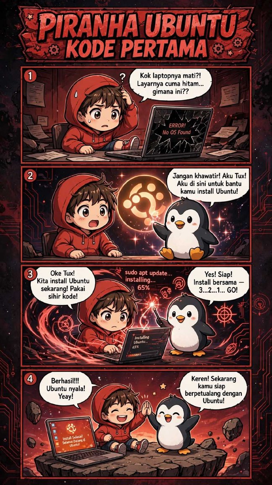
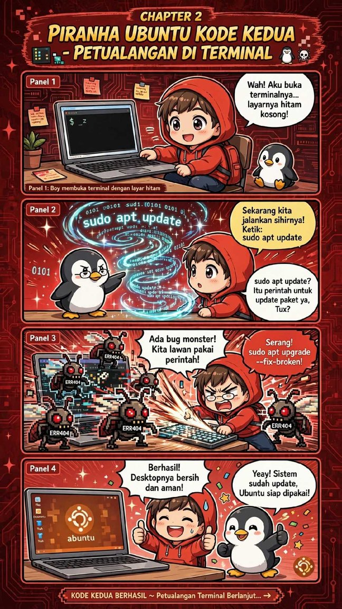
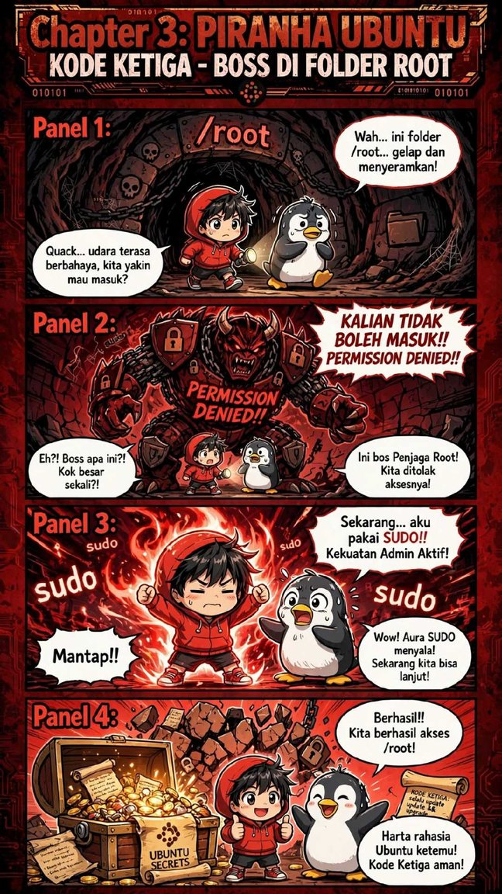
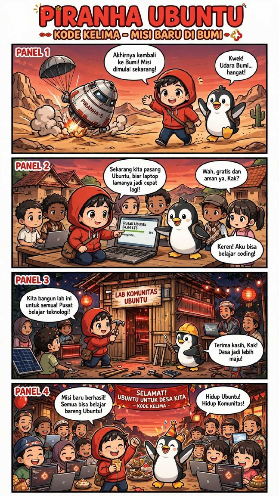
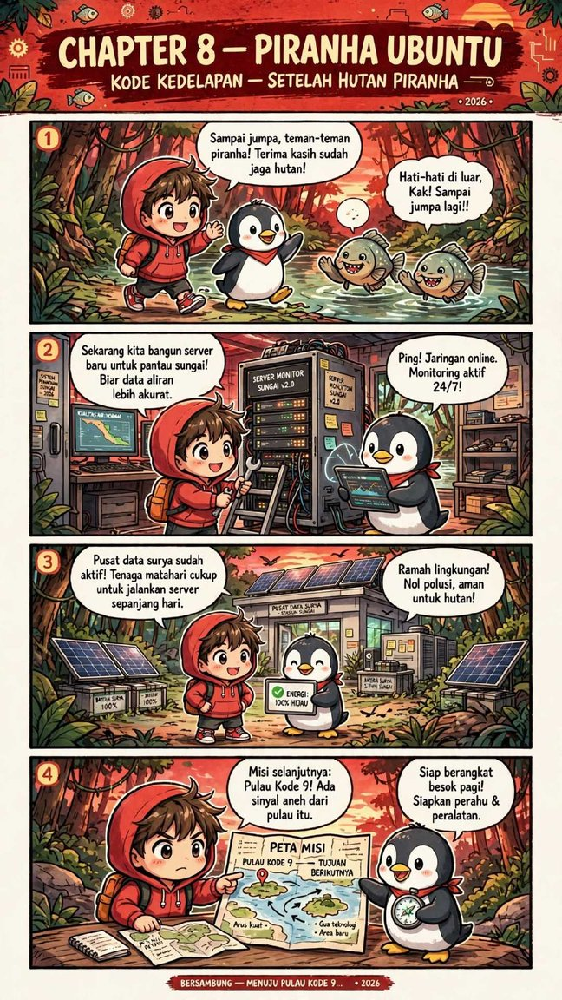
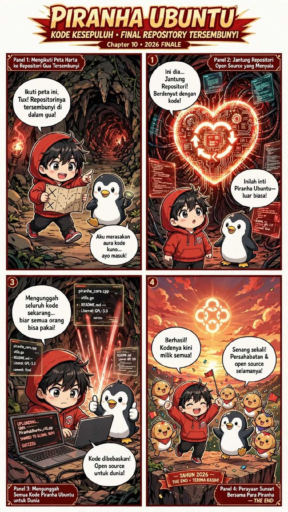

<div align="center">

# 🐟 PIRANHA UBUNTU 🐧
### *The Complete Saga — 10 Chapters 2026*

**Komik Edukasi Petualangan Linux, Terminal & Filosofi Open Source**  
*Karya Ilham Sugiri — Berbasis di Desa Panggungharjo, Bantul, D.I. Yogyakarta*

---

[](LICENSE)
[](https://ubuntu.com/)
[](#)
[-success.svg)](#daftar-bab--pembelajaran)
[](#cara-membaca--mengunduh)

<br/>


<br/>

> *"Di Desa Panggungharjo seorang bocah berhoodie merah bernama Riko mendadak terlibat petualangan tak terduga. Bersama Tux si Pinguin dan gotong royong warga, mereka menelusuri alur sungai, menguak misteri teknologi, dan membebaskan kode sumber untuk dunia!"*

</div>

---

## 📖 Tentang Komik

**Piranha Ubuntu** adalah serial komik edukatif yang menggabungkan keseruan cerita petualangan fiksi dengan pembelajaran teknis sistem operasi **Linux Ubuntu** dan filosofi **Free & Open Source Software (FOSS)**.

Buku komik ini dirancang agar konsep-konsep teknis Linux seperti manajemen paket (`apt`), hak akses (`sudo` dan root), penanganan bug, otomasi server ramah lingkungan, hingga lisensi kode terbuka dapat dipahami dengan mudah dan menyenangkan oleh anak-anak, pelajar, maupun pemula di dunia teknologi.

---

## 👥 Tokoh Utama

| Karakter | Peran & Deskripsi |
| :--- | :--- |
| **Riko** | Bocah berhoodie merah yang penuh rasa ingin tahu dari Desa Panggungharjo. Belajar Linux dari nol hingga mahir memecahkan bug dan mengelola sistem. |
| **Tux** | Pinguin maskot Linux yang bijak, ramah, dan selalu siap mendampingi serta mengajari Riko mantra-mantra sakti terminal Ubuntu. |
| **Warga Panggungharjo** | Komunitas desa yang menjunjung tinggi semangat gotong royong dan antusias belajar teknologi baru. |
| **Suku Piranha Ramah** | Penjaga ekosistem sungai dan hutan yang hidup berdampingan secara harmonis dengan teknologi bersih. |

---

## 📑 Daftar Bab & Materi Edukasi Linux

Setiap bab dalam komik ini mengemas materi praktis Linux yang relevan:

| Bab | Judul Chapter | Konsep Linux & Teknologi yang Diajarkan |
| :---: | :--- | :--- |
| **01** | **Kode Pertama** | Mengatasi masalah *“No OS Found”*, pengenalan sistem operasi bebas, dan proses instalasi Ubuntu. |
| **02** | **Petualangan di Terminal** | Membuka CLI (*Command Line Interface*), memperbarui repositori dengan `sudo apt update`, dan memperbaiki dependensi rusak dengan `sudo apt upgrade --fix-broken`. |
| **03** | **Boss di Folder Root** | Memahami struktur direktori Linux, hierarki folder `/root`, proteksi izin akses (*Permission Denied*), dan hak administratif superuser via `sudo`. |
| **04** | **Petualangan Luar Angkasa** | Logika pemecahan masalah (*debugging*), patching software sistem navigasi di modul stasiun luar angkasa. |
| **05** | **Misi Baru di Bumi** | Menghidupkan kembali komputer/laptop lawas dengan **Ubuntu 24.04 LTS**, serta mendirikan **Lab Komunitas Ubuntu** di desa. |
| **06** | **Festival Ubuntu 2026** | Komunitas FOSS, lomba kreasi, dan inovasi IoT: *Piranha Ubuntu Bot* untuk pemantauan danau secara real-time ke cloud. |
| **07** | **Petualangan Hutan Piranha** | Pemasangan sensor lingkungan bertenaga surya berbasis Ubuntu untuk restorasi kualitas air sungai. |
| **08** | **Setelah Hutan Piranha** | Pembangunan server pemantau mandiri energi (*Green Data Center* / 100% energi surya) yang aktif 24/7 tanpa polusi. |
| **09** | **Pulau Kode 9** | Eksplorasi server tahan banting (*Ubuntu Server 26.04 LTS*), pengenalan kriptografi, pemecahan teka-teki kunci dekripsi. |
| **10** | **Final Repository Tersembunyi** | Inti filosofi open source: mengunggah kode sumber (`piranha_core.cpp`, `utils.go`) di bawah lisensi terbuka **GPL-3.0** agar dapat dimanfaatkan oleh seluruh umat manusia. |

---

## 🖼️ Galeri Cuplikan Halaman

<div align="center">

| Bab 1: Instalasi | Bab 2: Terminal | Bab 3: Folder Root |
| :---: | :---: | :---: |
|  |  |  |

| Bab 5: Lab Desa | Bab 8: Green Server | Bab 10: Open Source Finale |
| :---: | :---: | :---: |
|  |  |  |

</div>

---

## 🚀 Cara Membaca & Mengunduh

### 1. Unduh Dokumen Lengkap (PDF)
Anda dapat langsung mengunduh file komik kompilasi berformat PDF (13 Halaman Full Color):
* 📄 **[Download PIRANHA_UBUNTU_LENGKAP_FINAL_13HAL.pdf](PIRANHA_x5f_UBUNTU_x5f_LENGKAP_x5f_FINAL_x5f_13HAL.pdf)**

### 2. Baca Online Melalui Web Reader (GitHub Pages)
Repositori ini dilengkapi dengan web reader interaktif responsif. Anda dapat membaca komik ini langsung di browser desktop maupun smartphone tanpa perlu mengunduh PDF.
* Cukup buka tautan: `https://<username>.github.io/piranha-ubuntu/` *(setelah mengaktifkan GitHub Pages di repositori Anda)*.

### 3. Membaca Gambar per Halaman di Repositori
Semua lembar komik tersedia dalam format gambar beresolusi tinggi di direktori [`assets/pages/`](assets/pages/).

---

## 💻 Praktek Perintah Terminal (Sesuai Komik)

Ingin mencoba perintah-perintah Linux yang dijalankan Riko dan Tux? Buka terminal Anda (`Ctrl + Alt + T` di Ubuntu) dan coba:

```bash
# 1. Memperbarui daftar paket repositori Ubuntu (Bab 2)
sudo apt update

# 2. Memperbarui aplikasi & memperbaiki paket yang bermasalah (Bab 2)
sudo apt upgrade --fix-broken -y

# 3. Mengetahui siapa user aktif & hak akses (Bab 3)
whoami

# 4. Mengecek versi rilis Ubuntu Anda (Bab 5 & Bab 9)
lsb_release -a

# 5. Menjalankan skrip simulasi edukasi dari folder proyek ini:
bash code-examples/01_kenalan_terminal.sh
```

*(Kumpulan skrip latihan interaktif dapat dilihat pada folder [`code-examples/`](code-examples/))*

---

## 👨‍💻 Profil Kreator / Penulis

* **Nama:** **Ilham Sugiri**
* **Peran:** Android Developer & Software Lab
* **Pengalaman:** 15+ Tahun Pengguna & Penggiat Linux Ubuntu
* **Karya:** Pembuat aplikasi *Vortex File Manager & Cloud Productivity & Creative Suite*
* **Spesialisasi:** Android Native, System Security, File Management Tools
* **Domisili:** Desa Panggungharjo, Kec. Sewon, Kab. Bantul, D.I. Yogyakarta, Indonesia
* **Kontak Email:** [ilham.piranha08@gmail.com](mailto:ilham.piranha08@gmail.com)

---

## 📜 Lisensi & Hak Cipta

* **Karya Komik & Ilustrasi Visual:** Dilisensikan di bawah lisensi **[Creative Commons Attribution-ShareAlike 4.0 International (CC BY-SA 4.0)](LICENSE)**. Anda bebas membagikan, mencetak, dan mengadaptasi karya ini untuk tujuan edukasi dengan tetap mencantumkan atribusi kepada Ilham Sugiri.
* **Kode Sumber Pendukung (Code Examples):** Dilisensikan di bawah lisensi **[GNU General Public License v3.0 (GPL-3.0)](https://www.gnu.org/licenses/gpl-3.0.html)** sesuai dengan semangat Open Source di Bab 10 komik ini.

---

<div align="center">
  <sub>Dibuat dengan ❤️ dan semangat Open Source dari Desa Panggungharjo untuk Dunia.</sub><br/>
  <b>Hidup Ubuntu! Hidup Komunitas! 🐧✨</b>
</div>
